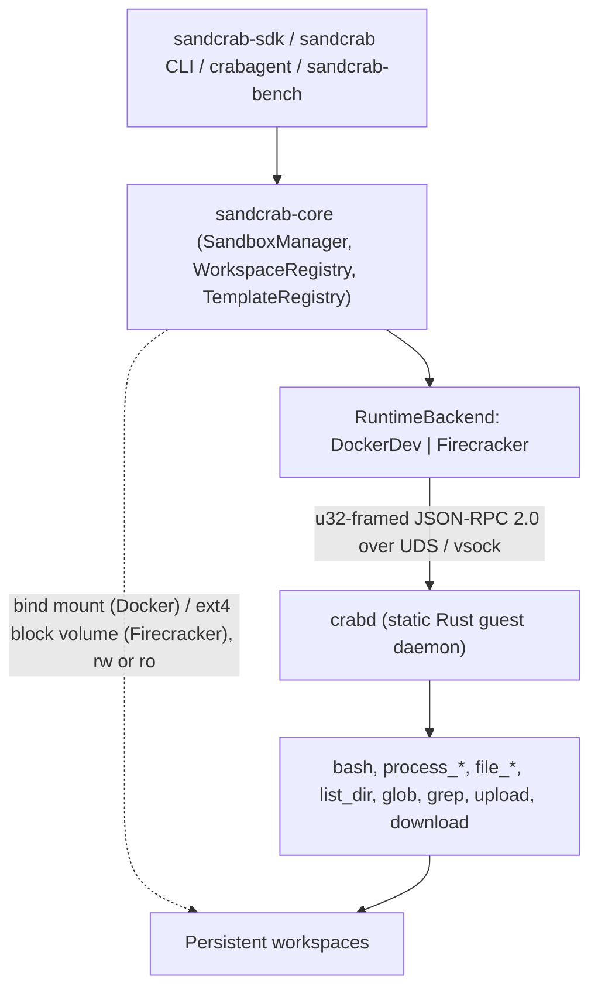

# Sandcrab

<p align="center">
  
</p>

**Sandcrab** is an open-source, self-hostable, Rust-based ephemeral sandbox manager and SDK for running untrusted agent code.

## Why Sandcrab?

AI coding and computer-use agents need to run untrusted commands, edit files, install packages, and render outputs safely and cheaply:

- **Ephemeral Compute, Durable Workspaces**: Spin up fresh sandboxes per turn, mount one or more persistent workspaces (`rw` or `ro`) with a chosen `default_cwd`, tear down immediately, and mutate workspace files from the host between turns (e.g., adding user attachments or handing output from `python-dev` to `render`).
- **Built-In Computer-Use Tools**: Native Rust guest daemon (`crabd`) providing `bash`, `file_read`, `file_write`, `file_edit`, `file_delete`, `file_move`, `list_dir`, `glob`, `grep`, and managed background `process_*` — all with auto-generated JSON Schemas for LLM tool-calling and MCP.
- **Curated OCI Templates**: Standard `Dockerfile` + `sandcrab.toml` templates (`base`, `python-dev`, `ts-dev`, `render`) with SHA-256 artifact pinning, ready for a future template marketplace.
- **Explicit Isolation Backends**: Pluggable `RuntimeBackend` supporting Docker (dev/CI only), `libkrun` (macOS Apple Silicon & Linux microVMs), Cloud Hypervisor (`virtio-fs` Linux microVMs), and Firecracker (high-density Linux KVM microVMs with sub-50ms snapshot restores). Never silently falls back to weaker isolation.

> V1 ships the DockerDev and Firecracker backends. libkrun, Cloud Hypervisor and snapshots
> are on the roadmap. See [Status](#status).

## What it is

A Rust library, CLI and guest daemon that give an AI agent a fresh, disposable Linux
sandbox per task, with the files it works on kept in **persistent workspaces** outside the
sandbox. Every backend runs the same static guest daemon, `crabd`, and speaks the same
length-prefixed JSON-RPC protocol, so a tool call behaves identically on a laptop
(DockerDev) and on a KVM server (Firecracker).

## Status

V1 (Phase 1, branch `feat/phase-1`): review passed, live agent run passed, DockerDev
benchmarked.

| Backend | Isolation | State |
| --- | --- | --- |
| **DockerDev** | Shared host kernel, **not a security boundary** | **Working.** Dev / CI only; requires `--allow-insecure`. End-to-end tests, live crabagent run and benchmark done |
| **Firecracker** | Hardware (KVM microVM) | **Built, KVM tests pending.** Backend, rootfs pipeline, vsock transport, block-volume workspaces, tap networking and CLI wiring are implemented and tested against a fake VMM. Real-KVM e2e tests and the benchmark wait for a KVM host. Reports `multi_tenant_safe = false` until `jailer` lands. No published ports yet |
| Cloud Hypervisor | Hardware | Phase 2 |
| libkrun | Hardware (macOS + Linux) | Phase 2 |

| Feature | State |
| --- | --- |
| 16 native tools in `crabd` (`bash`, `file_*`, `list_dir`, `glob`, `grep`, `process_*`, `upload`, `download`) | Done |
| Persistent workspaces: managed or registered host dir, multi-mount `rw`/`ro`, host mutation between turns | Done |
| Templates `base`, `python-dev`, `ts-dev`, `render` with SHA-256 image pins | Done |
| Network policy `disabled` / `unrestricted` | Done |
| Egress allowlist (`egress_restricted`), secret injection | **Not enforced:** refused at spawn time (Phase 3 proxy) |
| Snapshots / fork, browser tools, server, MCP, other-language SDKs | Phase 2+ |

Benchmark (DockerDev, 2-vCPU VPS): spawn→ready p50 227–258 ms, teardown about 100 ms,
first tool call about 3.7 ms. Full report: [docs/site/bench-report.html](docs/site/bench-report.html).

## Quickstart (Linux + Docker)

Prerequisites: Linux x86_64 or aarch64, Docker with your user in the `docker` group, Rust
(rustup) with the musl target, and `musl-tools`.

```sh
git clone https://github.com/polvera-org/sandcrab && cd sandcrab
rustup target add "$(uname -m)-unknown-linux-musl"
sudo apt-get install -y musl-tools

scripts/build-crabd.sh                 # static musl crabd, injected into every sandbox
templates/build.sh --pin               # build the 4 template images and pin their IDs
cargo build --release -p sandcrab-cli
export PATH="$PWD/target/release:$PATH"

sandcrab doctor                        # crabd, Docker, template pins, KVM prerequisites
```

Run commands from the repo root: `./templates` and the default `crabd` path are relative.

```sh
# DockerDev shares the host kernel: you must say so, every time.
export SANDCRAB_BACKEND=docker SANDCRAB_ALLOW_INSECURE=1

sandcrab workspace create demo
echo 'print("hello from the host")' | sandcrab workspace put demo hello.py -

sandcrab run -t python-dev -m demo:/workspace -- 'python3 hello.py && python3 --version'
sandcrab tool -m demo:/workspace grep '{"pattern":"hello"}'
sandcrab tool -m demo:/workspace file_edit \
  '{"path":"hello.py","old_string":"host","new_string":"sandbox"}'
sandcrab workspace cat demo hello.py
```

Each `run` / `tool` spawns a fresh sandbox, mounts the workspace, and destroys the sandbox
on exit. The workspace persists. The flags can also be given per command:
`sandcrab --backend docker --allow-insecure run ...`. Full reference: [docs/cli.md](docs/cli.md).

## Rust SDK

```rust
use sandcrab_sdk::{DockerDevConfig, MountMode, SandboxConfig, Sandcrab};

#[tokio::main]
async fn main() -> sandcrab_sdk::Result<()> {
    // No default backend, no fallback. DockerDev shares the host kernel: explicit opt-in.
    let sandcrab = Sandcrab::builder()
        .docker(DockerDevConfig::allow_insecure())
        .templates_dir("templates")
        .build()?;

    // Persistent workspaces live on the host; mutate them between agent turns.
    let ws = sandcrab.workspaces();
    ws.create("project")?;
    ws.create("attachments")?;
    ws.put_file("attachments", "spec.md", b"# Spec\nPrint hello.\n")?;

    // Ephemeral sandbox: one rw workspace (the cwd) and one ro workspace.
    let sandbox = sandcrab
        .spawn(
            SandboxConfig::from_template("python-dev")
                .mount("project", "/workspace", MountMode::ReadWrite)
                .mount("attachments", "/attachments", MountMode::ReadOnly)
                .default_cwd("/workspace"),
        )
        .await?;

    sandbox.file_write("hello.py", "print('hello')\n").await?;
    let out = sandbox.bash("python3 hello.py && cat /attachments/spec.md").await?;
    println!("exit={:?}\n{}", out.exit_code, out.stdout);

    // LLM tool use: tool name + JSON input from the model, JSON reply back.
    let reply = sandbox
        .tool_dispatch("grep", serde_json::json!({ "pattern": "hello" }))
        .await
        .expect("sandbox is alive");
    println!("{reply}");

    let timings = sandbox.destroy().await?;
    println!("spawn→ready: {:?}", timings.spawn_ready());
    Ok(())
}
```

Dependencies: `sandcrab-sdk` (feature `docker` is on by default; `firecracker` is opt-in,
Linux only), `tokio` and `serde_json`. Feed `sandbox.tool_definitions()` (or `sandcrab
tools schema`) to the model as its tool list. More in the crate docs
([`crates/sandcrab-sdk/src/lib.rs`](crates/sandcrab-sdk/src/lib.rs)).

## crabagent

A minimal Claude coding agent whose only tools are Sandcrab's, used as the V1 test harness:

```sh
cargo build --release -p sandcrab-agent
echo 'ANTHROPIC_API_KEY=sk-ant-...' >> .env          # never commit .env
target/release/crabagent -w myproj --backend docker --allow-insecure          # REPL
target/release/crabagent -w myproj --backend docker --allow-insecure -p "write a CLI that ..."
target/release/crabagent -w site -t render --port 5173 --network unrestricted \
  --backend docker --allow-insecure -p "build and preview the site" --keep-alive 600
```

Guide: [docs/crabagent.md](docs/crabagent.md).

## Architecture



| Crate | Role |
| --- | --- |
| [`sandcrab-protocol`](crates/sandcrab-protocol/) | Framing, JSON-RPC envelope, typed tool params / results, JSON Schemas |
| [`sandcrab-guest`](crates/sandcrab-guest/) (`crabd`) | Guest daemon: the tools, `--unix` / `--tcp` / `--vsock`, PID 1 mode for microVMs |
| [`sandcrab-core`](crates/sandcrab-core/) | `RuntimeBackend`, `SandboxManager`, `WorkspaceRegistry`, `TemplateRegistry`, crabd client |
| [`sandcrab-backend-docker`](crates/sandcrab-backend-docker/) | DockerDev backend (dev / CI only) |
| [`sandcrab-backend-firecracker`](crates/sandcrab-backend-firecracker/) | Firecracker backend, rootfs pipeline, pinned artifacts |
| [`sandcrab-sdk`](crates/sandcrab-sdk/) | Public Rust SDK (`Sandcrab`, `Sandbox`, `WorkspaceClient`) |
| [`sandcrab-cli`](crates/sandcrab-cli/) (`sandcrab`) | Operator CLI |
| [`sandcrab-agent`](crates/sandcrab-agent/) (`crabagent`) | Claude coding-agent harness |
| [`sandcrab-bench`](crates/sandcrab-bench/) | Backend benchmark runner |

Templates: `base` (Debian 13 trixie-slim), `python-dev` (Python 3.15 + uv), `ts-dev`
(Node.js 26 + pnpm + bun + TypeScript, plus `python3`), `render` (Chromium + Playwright +
ffmpeg + ImageMagick + Typst).

## Security model

- **The sandbox is the boundary.** Inside it, `crabd` has no path jail; agents can touch
  anything the sandbox user can. Host-side workspace operations refuse traversal and
  symlink escapes.
- **No silent downgrades.** There is no default backend and no fallback. Each backend
  reports `BackendCapabilities` (`hardware_isolated`, `multi_tenant_safe`,
  `supports_snapshots`, `supports_host_dir_mounts`). A backend that is not hardware
  isolated is refused unless you opt in (`--allow-insecure`, `SANDCRAB_ALLOW_INSECURE=1`,
  `DockerDevConfig::allow_insecure()`).
- **DockerDev is not a security boundary.** It shares the host kernel. It is hardened
  (`cap_drop ALL`, `no-new-privileges`, PID / memory / CPU limits, `noexec` `/tmp`, no core
  dumps, host uid:gid, network `none` by default, ports on `127.0.0.1` only), but use it
  only for code you would run on the host yourself, and remember that `docker` group
  membership is root-equivalent.
- **Firecracker** is hardware isolated, but V1 reports `multi_tenant_safe = false` until
  the `jailer` (chroot, cgroups, seccomp) is wired in, and it has not yet run on real KVM.
- **Unenforceable policies fail.** `egress_restricted` network policies and `secrets` are
  refused at spawn time rather than ignored. The egress proxy is Phase 3.
- **Pinned inputs.** Template images must match their `sha256` pin (`--allow-unpinned`
  overrides on DockerDev); the Firecracker kernel and binaries are SHA-256 verified on
  download and on every use.
- Known open items (Phase 2, MEDIUM): two registries with different `SANDCRAB_HOME` can
  still nest workspace roots, and the Docker / Firecracker pack paths resolve the bind
  path after verification (a narrow race). See [docs/ROADMAP.md](docs/ROADMAP.md#v1-status).

## Documentation

| | |
| --- | --- |
| [docs/protocol.md](docs/protocol.md) | Wire protocol, error codes, every tool's params, results and limits |
| [docs/cli.md](docs/cli.md) | `sandcrab` commands, flags, env vars, exit codes |
| [docs/crabagent.md](docs/crabagent.md) | crabagent setup, flags, mounts, ports, caches, images |
| [docs/hosting.md](docs/hosting.md) | Dev host (Docker hardening) and KVM host (Firecracker) setup |
| [docs/ROADMAP.md](docs/ROADMAP.md) | Phases, V1 status, what is pending |
| [docs/design/firecracker-backend.md](docs/design/firecracker-backend.md) | Firecracker backend design |
| [docs/decisions/0001-phase-1-decisions.md](docs/decisions/0001-phase-1-decisions.md) | V1 decisions (ADR) |
| [docs/bench/README.md](docs/bench/README.md) | Running the benchmarks |
| [docs/bench/live-check.md](docs/bench/live-check.md) | Live crabagent run report |
| [BRIEF.md](BRIEF.md), [AGENTS.md](AGENTS.md) | Product brief; rules for contributors and coding agents |

**Local site** ([docs/site/](docs/site/index.html)): walkthrough of the repo, a 3D
presentation, the benchmark report, the crab symbology and the landing page crabagent
built. Serve it over HTTP (the 3D scenes and the landing page do not work from
`file://`):

```sh
python3 -m http.server -d docs/site 8000     # then open http://127.0.0.1:8000/
```

## License

Apache-2.0, as declared for every crate in [`Cargo.toml`](Cargo.toml).
