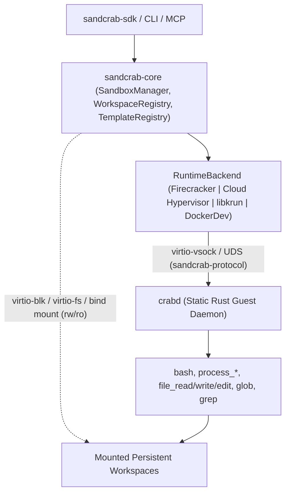

# Sandcrab

**Sandcrab** is an open-source, self-hostable, Rust-based ephemeral sandbox manager and SDK for running untrusted agent code.

<p align="center">
  
</p>
> An architect of the impermanent, born of iron and grit, carving safe harbors from the chaotic shoreline.

## Why Sandcrab?

AI coding and computer-use agents need to run untrusted commands, edit files, install packages, and render outputs safely and cheaply:

- **Ephemeral Compute, Durable Workspaces**: Spin up fresh sandboxes per turn, mount one or more persistent workspaces (`rw` or `ro`) with a chosen `default_cwd`, tear down immediately, and mutate workspace files from the host between turns (e.g., adding user attachments or handing output from `python-dev` to `render`).
- **Built-In Computer-Use Tools**: Native Rust guest daemon (`crabd`) providing `bash`, `file_read`, `file_write`, `file_edit`, `file_delete`, `file_move`, `list_dir`, `glob`, `grep`, and managed background `process_*` — all with auto-generated JSON Schemas for LLM tool-calling and MCP.
- **Curated OCI Templates**: Standard `Dockerfile` + `sandcrab.toml` templates (`base`, `python-dev`, `ts-dev`, `render`) with SHA-256 artifact pinning, ready for a future template marketplace.
- **Explicit Isolation Backends**: Pluggable `RuntimeBackend` supporting Docker (dev/CI only), `libkrun` (macOS Apple Silicon & Linux microVMs), Cloud Hypervisor (`virtio-fs` Linux microVMs), and Firecracker (high-density Linux KVM microVMs with sub-50ms snapshot restores). Never silently falls back to weaker isolation.

## Architecture



## Workspace Structure

```text
sandcrab/
├── BRIEF.md                      # Product brief, research verdict & open decisions
├── AGENTS.md / CLAUDE.md         # Engineering guidelines & handoff instructions for AI agents
├── docs/
│   └── ROADMAP.md                # Phased implementation plan & tool catalog
├── crates/
│   ├── sandcrab-protocol/        # Wire protocol, ToolCall/ToolResult types & JSON Schemas
│   ├── sandcrab-core/            # RuntimeBackend trait, Workspace, TemplateManifest, SandboxConfig
│   ├── sandcrab-guest/           # `crabd` static Rust daemon running inside sandboxes
│   ├── sandcrab-backend-docker/  # Phase 1 dev/CI backend (explicitly non-multi-tenant)
│   ├── sandcrab-sdk/             # Ergonomic async Rust SDK
│   └── sandcrab-cli/             # `sandcrab` CLI (doctor, workspace, template, run)
└── templates/
    ├── base/                     # Debian 13 (trixie-slim) + core utilities
    ├── python-dev/               # Python 3.15 + uv + ruff + pytest + mypy
    ├── ts-dev/                   # Node.js 26 Active LTS + pnpm + bun + TypeScript
    └── render/                   # Chromium + Playwright + ffmpeg + ImageMagick + Typst
```

## Target SDK Ergonomics

```rust
use sandcrab_core::{MountMode, SandboxConfig};
use sandcrab_sdk::Sandcrab;

let manager = Sandcrab::builder()
    .backend(backend)
    .workspace_root("./.sandcrab/workspaces")
    .build()?;

let project = manager.workspaces().create("project-alpha").await?;
let attachments = manager.workspaces().create("attachments").await?;
manager.workspaces().put_file(&attachments.id, "spec.pdf", pdf_bytes).await?;

let sandbox = manager
    .create(
        SandboxConfig::from_template("python-dev")
            .mount(&project.id, "/workspace/project", MountMode::ReadWrite)
            .mount(&attachments.id, "/workspace/attachments", MountMode::ReadOnly)
            .default_cwd("/workspace/project")
            .timeout_secs(300),
    )
    .await?;

let output = sandbox.bash("python3 --version").await?;
sandbox.destroy().await?;
```

## Status

**Initial scaffold & architecture phase.** See [BRIEF.md](BRIEF.md) and [docs/ROADMAP.md](docs/ROADMAP.md) for the phased implementation roadmap and open design decisions.
