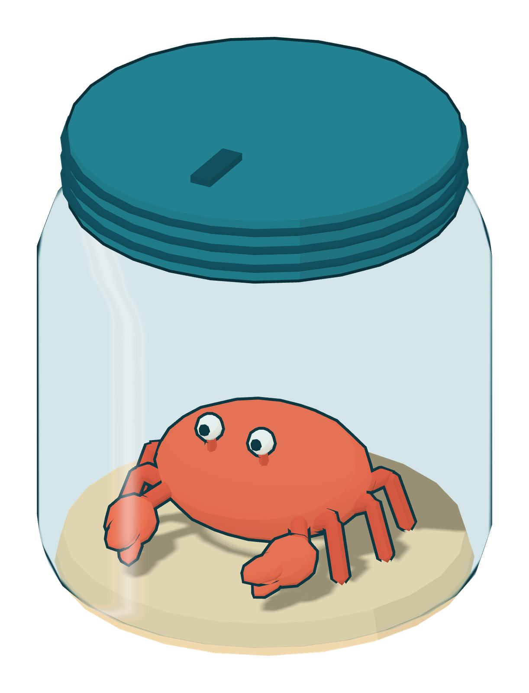
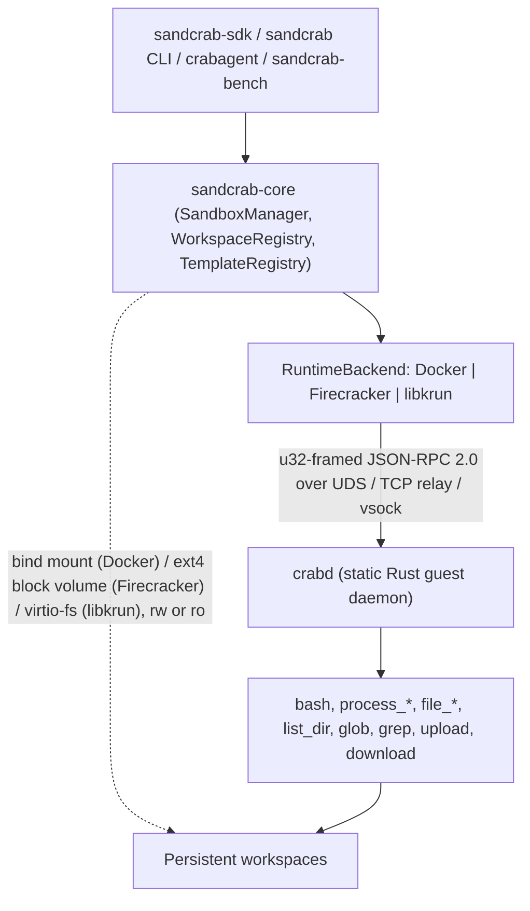

# Sandcrab

<p align="center">
  
</p>

**Sandcrab** is an open-source, self-hostable, Rust-based ephemeral sandbox manager and SDK for running untrusted agent code.

## Why Sandcrab?

AI coding and computer-use agents need to run untrusted commands, edit files, install packages, and render outputs safely and cheaply:

- **Ephemeral Compute, Durable Workspaces**: Spin up fresh sandboxes per turn, mount one or more persistent workspaces (`rw` or `ro`) with a chosen `default_cwd`, tear down immediately, and mutate workspace files from the host between turns (e.g., adding user attachments or handing output from `python-dev` to `render`).
- **Built-In Computer-Use Tools**: Native Rust guest daemon (`crabd`) providing `bash`, `file_read`, `file_write`, `file_edit`, `file_delete`, `file_move`, `list_dir`, `glob`, `grep`, and managed background `process_*` — all with auto-generated JSON Schemas for LLM tool-calling and MCP.
- **Curated OCI Templates**: Standard `Dockerfile` + `sandcrab.toml` templates (`base`, `python-dev`, `ts-dev`, `render`) with SHA-256 artifact pinning, ready for a future template marketplace.
- **Explicit Isolation Backends**: Pluggable `RuntimeBackend` supporting hardened Docker containers (shared kernel, for trusted single-tenant workloads; Linux Docker Engine or Docker Desktop on macOS), Firecracker (Linux KVM microVMs) and libkrun (microVMs on Apple Silicon macOS and Linux KVM, with live `virtio-fs` workspaces). Cloud Hypervisor is planned. Never silently falls back to weaker isolation.

> Sandcrab ships the Docker, Firecracker and libkrun backends. Cloud Hypervisor, snapshots
> and the egress proxy are on the roadmap. See [Status](#status).

## What it is

A Rust library, CLI and guest daemon that give an AI agent a fresh, disposable Linux
sandbox per task, with the files it works on kept in **persistent workspaces** outside the
sandbox. Every backend runs the same static guest daemon, `crabd`, and speaks the same
length-prefixed JSON-RPC protocol, so a tool call behaves identically on a laptop
(Docker or libkrun) and on a KVM server (Firecracker or libkrun).

## Status

V1 (Phase 1) plus the libkrun backend flow, on branch `feat/phase-1`. The last flow review
verdict was "ship with follow-ups" (no critical, high or open medium findings; backlog in
[docs/ROADMAP.md](docs/ROADMAP.md#next)).

| Backend | Hosts | `hardware_isolated` | `multi_tenant_safe` | Workspaces | State |
| --- | --- | --- | --- | --- | --- |
| **Docker** | Linux (Docker Engine); macOS (Docker Desktop, over a token-authenticated loopback TCP relay) | no: shared host kernel, hardened | no | Live bind mount | **Officially supported** for single-tenant and trusted-host workloads. e2e suites pass on both transports |
| **Firecracker** | Linux x86_64 + KVM | yes | no, until `jailer` confinement lands | Block drive, copied in at spawn and synced back at teardown | Real-KVM e2e suite passes. Published ports over vsock tunnels; `unrestricted` network through a tap pool and nftables |
| **libkrun** | macOS Apple Silicon (Hypervisor.framework); Linux x86_64 + KVM | yes | no: the device model runs in-process as the host user | **Live virtio-fs** | e2e suites pass on both platforms. `unrestricted` network through a pinned userspace netstack (gvproxy / passt) behind the helper's egress filter. Release signing with a Developer ID is documented but not yet validated |
| Cloud Hypervisor | Linux KVM | | | | Phase 2 |

| Feature | State |
| --- | --- |
| 16 native tools in `crabd` (`bash`, `file_*`, `list_dir`, `glob`, `grep`, `process_*`, `upload`, `download`) | Done |
| Persistent workspaces: managed or registered host dir, multi-mount `rw`/`ro`, host mutation between turns | Done |
| Templates `base`, `python-dev`, `ts-dev`, `render` (amd64 and arm64) with host-local image pins | Done; reproducible content digests are a follow-up |
| Network policy `disabled` / `unrestricted`, published ports | Done on every backend |
| Guest hardening in microVMs (dropped capabilities, `no_new_privs`, pids cap, hardening sysctls, read-only `/proc/sys` and `/sys`; fails closed) | Done; a guest seccomp profile is deferred |
| Connection auth (protocol 0.2: per-sandbox token on every `crabd` connection) | Done on Docker |
| Egress allowlist (`egress_restricted`), secret injection | **Not enforced:** refused at spawn time (Phase 3 proxy) |
| Snapshots / fork, browser tools, server, MCP, other-language SDKs | Phase 2+ |

**Benchmarks (indicative).** Spawn → ready, p50, `base` template, warm cache, no workspace,
n = 30 per cell. No run is marked valid by the harness (busy host, drift, or a reduced tier),
and the hosts differ, so read these as indicative, not as a ranking:

| Backend | Host | spawn → ready p50 |
| --- | --- | --- |
| Docker | dev-vps (2-vCPU VPS, SSD) | 227 ms (teardown ~100 ms, first call ~3.6 ms) |
| libkrun | mac-m2 (Apple M2 laptop, SSD) | 159 ms (teardown ~29 ms) |
| Firecracker | kvm-dedicated (bare-metal Xeon D-2141I, HDD RAID1) | 685 ms (teardown ~62 ms) |
| libkrun | kvm-dedicated | 424 ms in the Standard-tier run; ~238 ms in a later smoke run, after the per-spawn library hash was removed |
| Docker | kvm-dedicated | ~1.5 s: HDD-bound, not comparable (a bare `docker create` takes ~1 s there) |

Benchmarks at a glance: [docs/site/benchmarks.html](docs/site/benchmarks.html). Full report with every host's caveats: [docs/site/bench-report.html](docs/site/bench-report.html).

## Choosing a backend

The backend is always chosen explicitly (`--backend`, `SANDCRAB_BACKEND`, or the SDK
builder); Sandcrab never falls back from one to another.

| Workload | Backend |
| --- | --- |
| Your own agents, trusted code, single-tenant hosts | **Docker**: hardened containers, shared host kernel |
| A separate guest kernel on a developer Mac or a Linux KVM host, with live host-dir workspaces | **libkrun**: microVMs; the VMM runs as your user, so not for hostile multi-tenant code |
| Code from strangers on a Linux KVM server | **Firecracker**: KVM microVMs. Hardware isolated, but `multi_tenant_safe = false` until `jailer` confinement lands |
| Planned (Phase 2) | Cloud Hypervisor |

No backend reports `multi_tenant_safe = true` yet. Setup per host: [docs/hosting.md](docs/hosting.md).

## Install

Prebuilt archives are published on [GitHub Releases](https://github.com/polvera-org/sandcrab/releases)
for macOS arm64, Linux x86_64 and Linux arm64. Until the first release, build from source
([Quickstart](#quickstart-linux--docker)).

```sh
# pick your target: aarch64-apple-darwin, x86_64-unknown-linux-gnu, aarch64-unknown-linux-gnu
sha256sum -c sandcrab-<version>-<target>.tar.gz.sha256     # macOS: shasum -a 256 -c ...
tar -xzf sandcrab-<version>-<target>.tar.gz
cd sandcrab-<version>-<target>                             # then follow INSTALL.md
```

- **Linux** binaries need glibc 2.39 or newer (Ubuntu 24.04+, Debian 13+).
- **macOS** binaries are ad-hoc signed, not notarized yet. If a browser downloaded the
  archive, run `xattr -dr com.apple.quarantine .` in the extracted directory.
- **Windows** is not supported natively. Use WSL2 (Ubuntu) with the Linux x86_64 archive and
  the Docker backend (Docker Desktop's WSL integration, or Docker Engine inside WSL).

Maintainers: CI, release and e2e workflows are described in [docs/ci.md](docs/ci.md).

## Quickstart (Linux + Docker)

Prerequisites: Linux x86_64 or aarch64, Docker with your user in the `docker` group, Rust
(rustup) with the musl target, and `musl-tools`.

```sh
git clone https://github.com/polvera-org/sandcrab && cd sandcrab
rustup target add "$(uname -m)-unknown-linux-musl"
sudo apt-get install -y musl-tools

scripts/build-crabd.sh                 # static musl crabd, injected into every sandbox
templates/build.sh                     # build the 4 template images and pin them on this host
cargo build --release -p sandcrab-cli
export PATH="$PWD/target/release:$PATH"

sandcrab doctor                        # crabd, Docker, template pins, KVM prerequisites
```

Run commands from the repo root: `./templates` and the default `crabd` path are relative.

```sh
# The backend is always explicit: no default, no fallback.
export SANDCRAB_BACKEND=docker

sandcrab workspace create demo
echo 'print("hello from the host")' | sandcrab workspace put demo hello.py -

sandcrab run -t python-dev -m demo:/workspace -- 'python3 hello.py && python3 --version'
sandcrab tool -m demo:/workspace grep '{"pattern":"hello"}'
sandcrab tool -m demo:/workspace file_edit \
  '{"path":"hello.py","old_string":"host","new_string":"sandbox"}'
sandcrab workspace cat demo hello.py
```

Each `run` / `tool` spawns a fresh sandbox, mounts the workspace, and destroys the sandbox
on exit. The workspace persists. The backend can also be given per command:
`sandcrab --backend docker run ...`. Full reference: [docs/cli.md](docs/cli.md).

**On a Mac (Apple Silicon)** the same commands run in libkrun microVMs. With Docker Desktop
running (it builds the template images):

```sh
brew install libkrun libkrunfw e2fsprogs
export PATH="$(brew --prefix e2fsprogs)/sbin:$PATH"
rustup target add aarch64-unknown-linux-musl
scripts/build-crabd.sh && templates/build.sh
cargo build --release -p sandcrab-cli -p sandcrab-backend-libkrun
target/release/sandcrab libkrun install --helper target/release/sandcrab-krun
target/release/sandcrab doctor --backend libkrun
export SANDCRAB_BACKEND=libkrun
```

Details, including what `install` pins and signs: [docs/hosting.md](docs/hosting.md#2-macos-apple-silicon).

## Rust SDK

```rust
use sandcrab_sdk::{DockerConfig, MountMode, SandboxConfig, Sandcrab};

#[tokio::main]
async fn main() -> sandcrab_sdk::Result<()> {
    // No default backend, no fallback: pick one explicitly. Docker shares the host kernel;
    // add `.require_hardware_isolation(true)` to refuse any backend that is not a microVM.
    let sandcrab = Sandcrab::builder()
        .docker(DockerConfig::default())
        .templates_dir("templates")
        .build()?;

    // Persistent workspaces live on the host; mutate them between agent turns.
    let ws = sandcrab.workspaces();
    ws.create("project")?;
    ws.create("attachments")?;
    ws.put_file("attachments", "spec.md", b"# Spec\nPrint hello.\n")?;

    // Ephemeral sandbox: one rw workspace (the cwd) and one ro workspace.
    let sandbox = sandcrab
        .spawn(
            SandboxConfig::from_template("python-dev")
                .mount("project", "/workspace", MountMode::ReadWrite)
                .mount("attachments", "/attachments", MountMode::ReadOnly)
                .default_cwd("/workspace"),
        )
        .await?;

    sandbox.file_write("hello.py", "print('hello')\n").await?;
    let out = sandbox.bash("python3 hello.py && cat /attachments/spec.md").await?;
    println!("exit={:?}\n{}", out.exit_code, out.stdout);

    // LLM tool use: tool name + JSON input from the model, JSON reply back.
    let reply = sandbox
        .tool_dispatch("grep", serde_json::json!({ "pattern": "hello" }))
        .await
        .expect("sandbox is alive");
    println!("{reply}");

    let timings = sandbox.destroy().await?;
    println!("spawn→ready: {:?}", timings.spawn_ready());
    Ok(())
}
```

Dependencies: `sandcrab-sdk` (feature `docker` is on by default; `firecracker` is opt-in,
Linux only; `libkrun` is opt-in, macOS Apple Silicon and Linux, selected with
`.libkrun(LibkrunConfig)`), `tokio` and `serde_json`. Feed `sandbox.tool_definitions()` (or `sandcrab
tools schema`) to the model as its tool list. More in the crate docs
([`crates/sandcrab-sdk/src/lib.rs`](crates/sandcrab-sdk/src/lib.rs)).

## crabagent

A minimal Claude coding agent whose only tools are Sandcrab's, used as the V1 test harness:

```sh
cargo build --release -p sandcrab-agent
echo 'ANTHROPIC_API_KEY=sk-ant-...' >> .env          # never commit .env
target/release/crabagent -w myproj --backend docker          # REPL
target/release/crabagent -w myproj --backend docker -p "write a CLI that ..."
target/release/crabagent -w site -t render --port 5173 --network unrestricted \
  --backend docker -p "build and preview the site" --keep-alive 600
```

Guide: [docs/crabagent.md](docs/crabagent.md).

## Architecture



| Crate | Role |
| --- | --- |
| [`sandcrab-protocol`](crates/sandcrab-protocol/) | Framing, JSON-RPC envelope, typed tool params / results, JSON Schemas |
| [`sandcrab-guest`](crates/sandcrab-guest/) (`crabd`) | Guest daemon: the tools, `--unix` / `--tcp` / `--vsock`, PID 1 mode and guest hardening for microVMs, `crabd relay` |
| [`sandcrab-core`](crates/sandcrab-core/) | `RuntimeBackend`, `SandboxManager`, `WorkspaceRegistry`, `TemplateRegistry`, crabd client |
| [`sandcrab-backend-docker`](crates/sandcrab-backend-docker/) | Docker backend (hardened containers, shared kernel) |
| [`sandcrab-rootfs`](crates/sandcrab-rootfs/) | Shared microVM rootfs pipeline (OCI image → read-only ext4 with `crabd`), arch-aware, stamped cache |
| [`sandcrab-backend-firecracker`](crates/sandcrab-backend-firecracker/) | Firecracker backend, pinned kernel and binary, tap pool |
| [`sandcrab-backend-libkrun`](crates/sandcrab-backend-libkrun/) | libkrun backend and its `sandcrab-krun` helper (the VMM), runtime-loaded pinned libkrun, userspace netstack |
| [`sandcrab-sdk`](crates/sandcrab-sdk/) | Public Rust SDK (`Sandcrab`, `Sandbox`, `WorkspaceClient`) |
| [`sandcrab-cli`](crates/sandcrab-cli/) (`sandcrab`) | Operator CLI |
| [`sandcrab-agent`](crates/sandcrab-agent/) (`crabagent`) | Claude coding-agent harness |
| [`sandcrab-bench`](crates/sandcrab-bench/) | Backend benchmark runner |

Templates: `base` (Debian 13 trixie-slim), `python-dev` (Python 3.15 + uv), `ts-dev`
(Node.js 26 + pnpm + bun + TypeScript, plus `python3`), `render` (Chromium + Playwright +
ffmpeg + ImageMagick + Typst).

## Security model

- **The sandbox is the boundary.** Inside it, `crabd` has no path jail; agents can touch
  anything the sandbox user can. Host-side workspace operations refuse traversal and
  symlink escapes.
- **No silent downgrades.** There is no default backend and no fallback. Each backend
  reports `BackendCapabilities` (`hardware_isolated`, `multi_tenant_safe`,
  `supports_snapshots`, `supports_host_dir_mounts`). To refuse any backend without
  hardware isolation, set `require_hardware_isolation` (SDK builder or `SandboxConfig`);
  spawning then fails with `HardwareIsolationRequired`.
- **Docker is hardened, but shares the host kernel.** All capabilities dropped,
  `no-new-privileges`, pinned images, PID / memory / CPU limits, `noexec` `/tmp`, no core
  dumps, host uid:gid, network `none` by default, published ports on `127.0.0.1` only. It
  reports `hardware_isolated = false` and `multi_tenant_safe = false`: use it for your own
  agents and trusted code, not for hostile multi-tenant code. `docker` group membership is
  root-equivalent.
- **Firecracker** is hardware isolated, but reports `multi_tenant_safe = false` until
  the `jailer` (chroot, cgroups, seccomp) is wired in.
- **libkrun** is hardware isolated, but reports `multi_tenant_safe = false`: its device model
  (virtio-fs, vsock, block) runs in the helper process as the host user. TSI, libkrun's
  socket proxy that exposes host loopback, is never enabled implicitly; `unrestricted`
  goes through a pinned netstack behind a default-deny egress filter.
- **microVM guests harden themselves** before user code runs: empty capability bounding set,
  `no_new_privs`, a pids cap, hardening sysctls (no user namespaces, no unprivileged BPF,
  `io_uring` off, ...), read-only `/proc/sys` and `/sys`. A failed step refuses the spawn.
  There is no guest seccomp profile yet ([docs/design/guest-seccomp.md](docs/design/guest-seccomp.md)).
- **Unenforceable policies fail.** `egress_restricted` network policies and `secrets` are
  refused at spawn time rather than ignored. The egress proxy is Phase 3.
- **Pinned inputs.** Template images must match this host's pin, recorded when the host
  built them ([docs/template-pins.md](docs/template-pins.md)). That is local integrity, not
  provenance: image IDs do not reproduce across hosts yet, so only the `FROM` base images are
  digest-pinned in the repo. `--allow-unpinned` overrides on Docker. The Firecracker kernel
  and binaries, the libkrun libraries, netstack and helper, and cached rootfs images are
  SHA-256 pinned and checked through the same fd that is then used (a stat stamp avoids
  re-hashing unchanged files).
- Known open items: two registries with different `SANDCRAB_HOME` can still nest
  workspace roots, and the Docker bind / Firecracker pack paths resolve the workspace path
  after verification (a narrow race; libkrun pins its share roots by fd). The libkrun flow
  review left only low and info findings. See [docs/ROADMAP.md](docs/ROADMAP.md#next).

## Documentation

| | |
| --- | --- |
| [docs/protocol.md](docs/protocol.md) | Wire protocol, error codes, every tool's params, results and limits |
| [docs/cli.md](docs/cli.md) | `sandcrab` commands, flags, env vars, exit codes |
| [docs/crabagent.md](docs/crabagent.md) | crabagent setup, flags, mounts, ports, caches, images |
| [docs/hosting.md](docs/hosting.md) | Docker host (hardening), macOS (libkrun, Docker Desktop), Linux KVM host (Firecracker, libkrun), release signing |
| [docs/ci.md](docs/ci.md) | CI, release and e2e workflows; cutting a release; runners; platform notes |
| [docs/ROADMAP.md](docs/ROADMAP.md) | Phases, status, what is next |
| [docs/design/firecracker-backend.md](docs/design/firecracker-backend.md) | Firecracker backend design |
| [docs/design/libkrun-backend.md](docs/design/libkrun-backend.md) | libkrun backend design, netstack, pins, results |
| [docs/design/guest-seccomp.md](docs/design/guest-seccomp.md) | microVM guest hardening |
| [docs/template-pins.md](docs/template-pins.md) | Template pinning model (local integrity now, reproducible later) |
| [docs/reviews/libkrun-backend-review.md](docs/reviews/libkrun-backend-review.md) | libkrun flow review, re-review and follow-up backlog |
| [docs/decisions/0001-phase-1-decisions.md](docs/decisions/0001-phase-1-decisions.md) | V1 decisions (ADR) |
| [docs/bench/README.md](docs/bench/README.md) | Running the benchmarks |
| [docs/bench/live-check.md](docs/bench/live-check.md) | Live crabagent run report |
| [BRIEF.md](BRIEF.md), [AGENTS.md](AGENTS.md) | Product brief; rules for contributors and coding agents |

**Local site** ([docs/site/](docs/site/index.html)): walkthrough of the repo, a 3D
presentation, the benchmark report, the crab symbology and the landing page crabagent
built. Serve it over HTTP (the 3D scenes and the landing page do not work from
`file://`):

```sh
python3 -m http.server -d docs/site 8000     # then open http://127.0.0.1:8000/
```

## License

Apache-2.0, as declared for every crate in [`Cargo.toml`](Cargo.toml).
